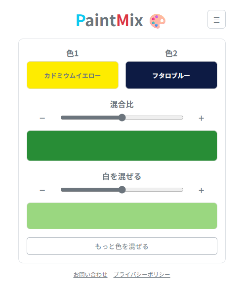

# PaintMix

絵の具の混色をシミュレーションするWebアプリケーションです。

**公開デモ：** https://paint.art-full-stack.com/



## 概要

複数の絵の具の色を混ぜ合わせたときの色の変化を、ブラウザ上で確認できます。

2色の混合比や白を混ぜる量を調整でき、さらに色を追加して混ぜることもできます。

## 主な機能

- 2色の混色と、混合比の調整
- 混色結果に白を混ぜる量の調整
- 混色の途中経過を示すグラデーションの表示
- 色を追加した混色（最大5色）と、混合比の分解表示
- 日本語・英語のUI
- 言語や色名の表示設定などをブラウザ内に保存

## 使用技術

- React
- TypeScript
- Vite
- Mixbox 2.0.0（混色処理）
- Vitest / Testing Library（テスト）
- Oxlint（静的解析）

## 技術的な取り組み

- React / TypeScriptによるUI設計と型安全な実装
- 混色の計算処理（`src/domain/`）と画面（`src/features/`）の分離
- 日本語・英語のメッセージを型で管理する多言語対応（`src/i18n/`）
- 混色処理と画面のテスト

## ローカル開発環境

### 必要な環境

- Node.js
- npm

### インストール

```bash
git clone https://github.com/TakahiroNago/paint-mix-app.git
cd paint-mix-app
npm install
```

### 開発サーバーの起動

```bash
npm run dev
```

### 本番ビルド

```bash
npm run build
```

型チェックと本番用ビルドを実行します。

### ビルド結果の確認

```bash
npm run preview
```

### テスト・静的解析

```bash
npm test
npm run lint
```

Vitestで、混色処理（`src/domain/mixing.test.ts`）と画面の操作（`src/features/mixer/MixerPages.test.tsx`）をテストします。

## Mixboxについて

混色処理には、外部ライブラリの[Mixbox](https://github.com/scrtwpns/mixbox)を使用しています。

MixboxはCC BY-NC 4.0ライセンスに基づき、非営利目的に限り利用できます。Copyright (c) 2022, Secret Weapons. All rights reserved.

## ライセンス

本プロジェクトのソースコードおよび利用している外部ライブラリのライセンス条件については、それぞれのライセンス情報を確認してください。
